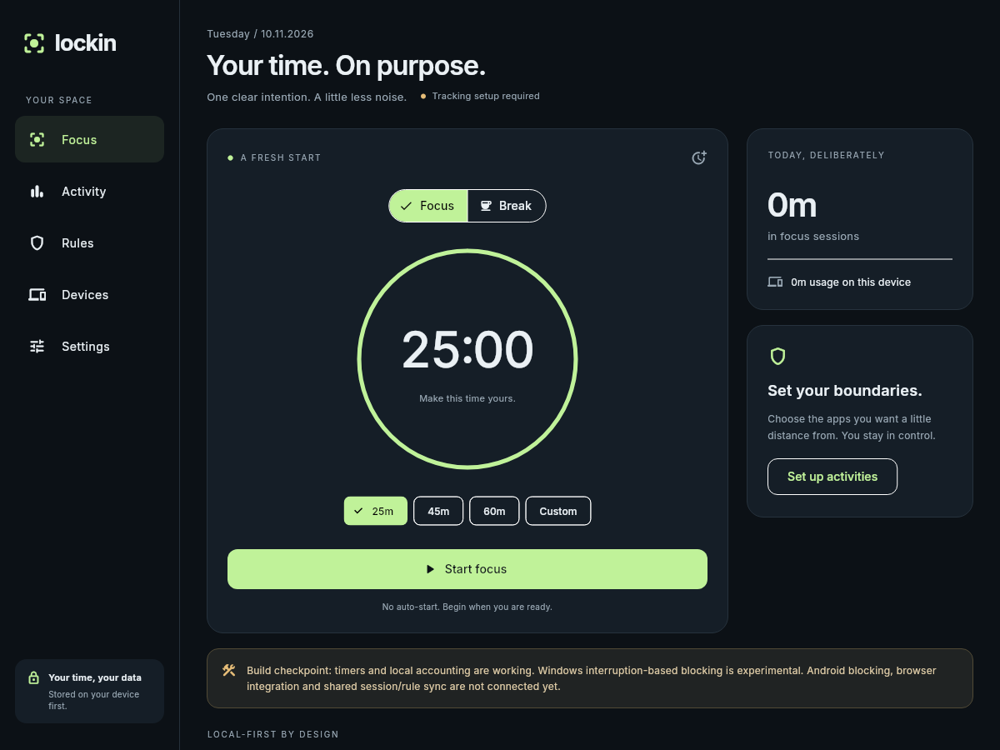

# Lockin

A local-first focus app for **Windows + Android**, built with Flutter/Dart. The approved full v1 scope is in [docs/v1-spec.md](docs/v1-spec.md).

**This is the first implementation checkpoint, not the completed v1.** The interface deliberately labels unfinished integrations. There is no fabricated usage or pretend live-device data.



Widget-rendered previews of the real app: [desktop](test/goldens/desktop.png) · [mobile](test/goldens/mobile.png) · [menu](test/goldens/mobile-menu.png) · [active focus](test/goldens/mobile-focus.png) · [break](test/goldens/mobile-break.png) · [completed](test/goldens/mobile-complete.png) · [maximized](test/goldens/desktop-wide.png).

The approved Focus design is just the time, one start/end control and a small menu. Duration, phase selection and navigation live in the menu; focused time is in Activity and individual budgets are in Rules. Focus stays dark in either system appearance, while secondary screens follow the system theme. The [throwaway comparison](https://github.com/danarrigo/lockin/tree/design/apple-focus-prototype/lib/ui/focus_prototype) remains separate from the production app.

## What is here

| Area | Current state |
| --- | --- |
| Interface | Approved minimal Focus screen wired to real state; immediate Lock in action; compact Windows utility window; matching phone layout; licensed Inter and Cupertino Icons |
| Timers | Pomodoro/custom durations, manual phase starts, deadline-based restoration, local session history |
| Accounting | Cross-device interval union, account-timezone days, daylight-saving boundaries, per-device totals |
| Rules | Local activity editor, focus restrictions, daily budgets, recurring/overnight windows, source-specific five-minute overrides |
| Storage | SQLite through Drift; durable intervals, settings and session history; safe upload acknowledgements |
| Windows | Win32 foreground reader, tray/close-to-tray, sign-in startup, voluntary focus-interruption screen; **not device-tested** |
| Android | Opt-in foreground service keeps one cached Flutter engine and SQLite usage journal alive after UI close; optional package-only Accessibility blocker; native validation in progress |
| Supabase | Email/password account UI, automatic confirmed-usage sync with retry/backoff, device heartbeats, per-user RLS migration; HTTP contract-tested, **not live-tested** |

### Still required for the approved v1

- Native validation of Android background collection and Accessibility blocking across UI close, reboot, lock, permission loss and OS termination. These paths are now implemented but are not yet release-verified. See [Android runtime](docs/android-runtime.md).
- Cross-device session, rule and account-timezone synchronization with explicit offline conflict handling. These currently remain local.
- Windows Chrome/Edge extension and its connection to the desktop app.
- Windows media-aware idle handling, crash/restart recovery, and tracking interruption reporting.
- Completion notifications, native end-to-end tests, signed packaging, and release/privacy review.

No claim of continuous background enforcement is justified until these paths pass physical-device and Windows tests. Force-stop, permission revocation, uninstalling and OS restrictions can still stop a consumer app.

## Development

Use **Flutter stable 3.47.9 / Dart 3.13.7** to reproduce the checked-in UI goldens. The session's persistent WSL SDK is `~/.local/share/lockin/flutter`. To use it in the current shell, run `export PATH="$HOME/.local/share/lockin/flutter/bin:$PATH"`. Windows builds require a separate Windows-side Flutter installation.

```sh
flutter pub get
flutter analyze
flutter test
```

Run on Windows with `flutter run -d windows`, or on an attached Android device with `flutter run -d <device-id>`.

### Windows and WSL

Editing in WSL/Neovim is fine. Windows builds require **Windows-side Flutter** and Visual Studio 2022's **Desktop development with C++** workload; Linux Flutter cannot build the Windows executable. Enable Windows Developer Mode for plugin symlinks. Android builds need the Java/Android SDK toolchain in the environment running Flutter, plus a device/emulator for end-to-end validation. Windows Android Studio's `.exe` tools are not a Linux Android toolchain.

The compatible `win32` 5.x / desktop-plugin dependency family is intentional: `launch_at_startup` currently depends on the 5.x registry bindings. Upgrade these together and revalidate native behavior, rather than forcing incompatible major versions.

### Supabase (optional; local mode needs no credentials)

1. In your own Supabase project, apply [the migration](supabase/migrations/202611100001_usage.sql), using the Supabase CLI or SQL editor.
2. Copy `config.example.json` to `config.local.json` and fill in your project URL and **public publishable key**. An older public anon key also works. Never use a service-role key.
3. Run `flutter run -d windows --dart-define-from-file=config.local.json` (or choose your Android device).
4. In Settings, create/confirm an account and sign in on each device. Confirmed usage then synchronizes automatically; **Sync now** retries immediately. Email confirmation/delivery settings belong to your Supabase project.

Usage sync uploads confirmed intervals idempotently and downloads today's data with explicit pagination. It does not extrapolate offline device activity. Device heartbeats are labelled **last contacted**, not proof of fresh activity. Global budgets can overshoot while disconnected. Shared timer/rule/timezone state is not implemented yet. Usage sync runs automatically every 30 seconds while signed in, retrying failed requests with backoff; Android background operation requires its visible foreground service.

Local history is bound to its first cloud account. Uploading it to a different account is refused; a safe account-switch/reset flow is still pending.

## Verification

- `flutter analyze` checks the Dart/Flutter code.
- `flutter test` exercises public timer/editor flows, actual SQLite close/reopen behavior, interval union, schedules, DST, override expiry and upload races.
- App-level widget tests cover immediate starts, deadline accuracy, real SQLite session restoration, immediately saved, independently remembered focus/break durations, manual phases, navigation during a timer, individual union-accounted budgets, and the blocking/override UI. They also cover keyboard-open forms, a 320-pixel short screen with doubled text and a warning, contrast, labeled controls and mobile tap targets. Idle, menu, running, break and completion goldens are generated by `flutter test --update-goldens`; inspect changes before accepting them.
- Android bridge tests exercise the real controller/store against a mocked OS method channel. Sync tests use a local HTTP server to exercise the actual Supabase client, pagination, retries, overlapping uploads and account binding. These do not prove Android OS behavior or server-side RLS.
- Native Android/Windows builds run in [GitHub Actions](.github/workflows/verify.yml), which publishes short-lived debug APK and unsigned Windows artifacts. Build success is not device-level enforcement verification. The migration's RLS behavior still needs a real Supabase test with two different users.

## Privacy and licensing

Cloud usage records contain app/domain identifiers and timestamps, never window titles, full URLs, screenshots, keystrokes or executable paths. Android automatic app-data backup is disabled. Local database/configuration files are ignored by git. Each cloud row is scoped to its authenticated owner.

Inter is bundled under its [SIL Open Font License](assets/fonts/OFL.txt). Symbols use the licensed Flutter Cupertino Icons package, not a proprietary Apple font.
