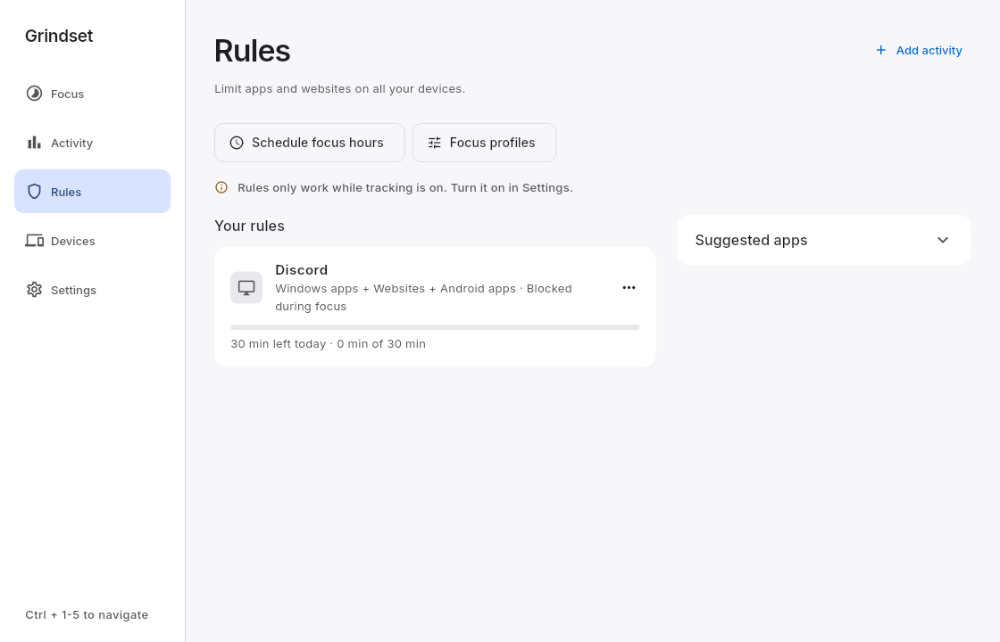

# Grindset

A local-first focus and activity tracker for **Windows and Android**. Set distraction budgets, schedule focus hours, and see recorded usage without collecting window titles, screenshots or keystrokes.

**[Download the latest release](https://github.com/danarrigo/grindset-releases/releases/latest)** · [Release notes](docs/releases/) · [Public website](https://danarrigo.github.io/grindset-releases/)

Grindset is personal-use software, not a tamper-proof lock or physical-device-certified blocker. Existing package IDs, storage identities and signing keys are retained from its former Lockin name so updates preserve data.



## Get started

1. Install the Windows x64 installer or release-signed Android ARM64 APK. Install updates over the existing app rather than uninstalling and losing local data.
2. Use **Rules** to select a starter, create an activity, or choose **All social media** for a combined budget across 17 supported services. Review and save; nothing is automatically enabled.
3. Enable tracking in **Settings**. Review **Tracking health** and the platform permissions. Android app blocking additionally needs the optional Accessibility service; website blocking needs the paired Windows browser extension.
4. Start a focus timer or configure **Schedule focus hours**. Keep Grindset/tracking running for restrictions to work.

If Android blocks installation, keep Play Protect enabled and report the exact warning and download source. A successful build or valid signature is not Play Protect approval; see [Google's warning guidance](https://developers.google.com/android/play-protect/warning-dev-guidance). A reported Android block is currently awaiting reproduction details.

Cloud sign-in is optional. Local timers, rules and recorded usage work without an account. Signing in synchronizes shared rules, daily budgets, schedules, timezone, the active timer and confirmed usage. Manual-focus selections, profiles, overrides and notification preferences remain device-local.

## Features

| Feature | Where and how |
| --- | --- |
| Focus timers | Minimal dark Focus screen, custom durations and manual focus/break starts. Timers restore from their deadlines. |
| Daily budgets | Link app/domain identifiers into an activity. Overlapping recorded intervals count once, including across devices. |
| Budget warnings | Optional **Settings > Budget warnings**: an on-screen heads-up at 80% of a daily budget, plus system notifications where permitted. Once per activity/account day; does not change limits or blocking. |
| Scheduled focus hours | **Rules > Schedule focus hours**. Multiple weekday/time windows, overnight hours and a visible account timezone; no timer needs to run. |
| Windows app selection | **Find apps on this PC** lists running/registered apps. Search/filter sources or browse for a local `.exe` without launching it. This is not a complete installed-package inventory. |
| Focus profiles | Work, Study, Sleep or custom groups of saved activities. Saving is inert; applying requires confirmation and changes only local manual-focus flags. Budgets, schedules and timer deadlines stay intact. |
| Tracking health | Observed collector checks, permissions/service state, Windows monitoring and authenticated browser contact. Unknown or unverified states are labeled, not presented as working protection. |
| Weekly insights | **Activity > Weekly insights**. Confirmed device-local trends, top app/site observations and transparent comparisons against current budgets. Missing days are unknown, not invented zeroes or productivity scores. |
| Data controls | Explicit private export and device-local reset. Reset does not delete cloud records. |
| Updates | **Settings > App updates > Check for updates**. Explicit checks and browser downloads, never silent installation. Versions before v1.2.0 need one manual update to obtain this feature. |

Windows uses a desktop-sized workspace, persistent sidebar, Ctrl+1-5 navigation and responsive multi-column screens. The mobile layout keeps navigation in the Focus menu and bottom tabs on secondary pages.

### Restriction behavior

- **Windows apps:** restricted foreground apps are minimized and a borderless explanation covers their monitor. Returning through Alt-Tab reapplies enforcement. Allowed apps restore the ordinary workspace; Windows recovery controls and deliberate quitting remain available. This does not kill or suspend app processes.
- **Websites:** the paired Chrome/Edge extension enforces host-based rules. Shared-host/PWA clients may need website rules instead of an executable rule.
- **Android:** opt-in background tracking uses a visible foreground service; optional Accessibility blocking uses package identifiers, not screen contents.
- A source-specific five-minute override leaves other restrictions in place. Offline devices can consume shared budgets before their confirmed records synchronize.

For existing activities created before Windows coverage was added, **Add desktop coverage** opens a reviewable edit. Sources, budgets and schedules are never silently broadened.

## Guides

- [Starter activities, Windows app selection and coverage](docs/rule-presets.md)
- [Scheduled focus hours](docs/scheduled-focus-hours.md) · [Focus profiles](docs/focus-profiles.md)
- [Tracking health](docs/tracking-health.md) · [Recorded weekly insights](docs/recorded-insights.md)
- [Browser extension](docs/browser-extension.md) · [Android runtime](docs/android-runtime.md)
- [Completion notifications](docs/completion-alerts.md) · [Budget warnings](docs/budget-warnings.md)
- [Data controls](docs/data-controls.md) · [Shared sync](docs/shared-sync.md)
- [Packaging and update compatibility](docs/packaging.md) · [App updates](docs/app-updates.md)

## Reliability and privacy boundaries

Automated builds/tests are not device-level certification. Controlled Windows checks cover restriction presentation, Alt-Tab return, overrides and scheduled blocking without a timer. Physical Android/OEM background recovery, comprehensive native-client/multi-monitor behavior and visible Windows notification delivery remain separate checks. OS permissions, notification settings, force-stop, quitting or uninstalling can stop a consumer app. A successful notification request does not prove visible delivery.

See [Windows acceptance](docs/windows-app-blocking.md), [Android evidence](docs/android-runtime.md) and [completion-alert evidence](docs/completion-alerts.md). The Windows installer is not trust-certificate signed; never disable security software to run it. Stable Android release APKs retain the owner signing key; short-lived CI debug APKs do not provide that update guarantee.

Cloud usage contains app/domain identifiers and timestamps, never full URLs, window titles, screenshots, keystrokes or executable paths. App selection reads static executable metadata, not window contents; installation paths are not saved as rule identifiers. Android automatic app-data backup is disabled. Exports are explicit and private. Local history stays bound to its first cloud account; export/reset before switching accounts. See [data controls](docs/data-controls.md).

## Development

Use Flutter stable satisfying [pubspec.yaml](pubspec.yaml). Checked-in UI goldens use Flutter **3.47.9 / Dart 3.13.7**. In this WSL environment: `export PATH="$HOME/.local/share/lockin/flutter/bin:$PATH"`.

```sh
flutter pub get
flutter analyze
flutter test
node --test extension/*.test.js test/site/*.test.mjs
```

Windows builds require Windows-side Flutter, Visual Studio's Desktop development with C++ workload and Developer Mode for plugin symlinks. Linux Flutter cannot build the Windows executable. Android builds require the Java/Android SDK toolchain for the environment running Flutter. The compatible win32 5.x/plugin dependency family is intentional; upgrade it together and revalidate native behavior.

For isolated native tests, use `--data-dir=<owned-test-folder> --local-only --no-alerts`. These avoid the normal journal, cloud/auth storage and OS alert requests; they do not weaken Windows security or change sign-in startup. Never test resets against a personal installation.

### Optional Supabase setup

Apply [migrations](supabase/migrations/) in filename order for a new project. For the existing deployment, consult [deployment history](docs/supabase-deployment.md) rather than replaying migrations blindly. Copy `config.example.json` to ignored `config.local.json` and supply only the project URL and **public publishable/anon key**, never a service-role key. Run with `--dart-define-from-file=config.local.json`. Email-confirmation delivery/redirect configuration belongs to the hosted project; see [deployment guidance](docs/supabase-deployment.md).

[GitHub Actions](.github/workflows/verify.yml) checks Flutter, extension/site behavior, real PostgreSQL migrations/RLS and native builds. Widget/OS-channel mocks do not prove physical delivery or background reliability. Review regenerated goldens before accepting them. Detailed feature evidence and remaining checks live in the linked guides and release notes, not in fabricated live-device data.

## Licensing

Inter is bundled under its [SIL Open Font License](assets/fonts/OFL.txt). Symbols use the licensed Flutter Cupertino Icons package, not a proprietary Apple font. App source remains private; the [public distribution repository](https://github.com/danarrigo/grindset-releases) contains the website, feed and release assets only.
